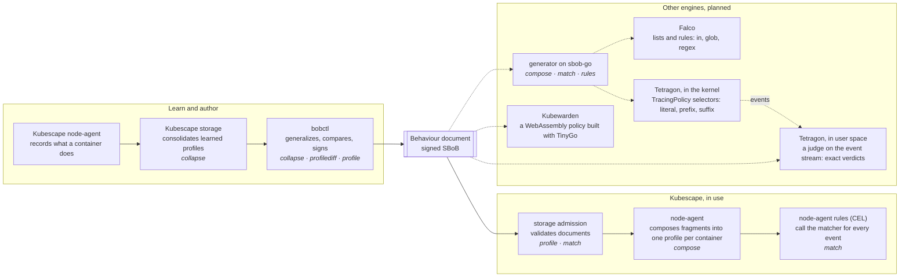
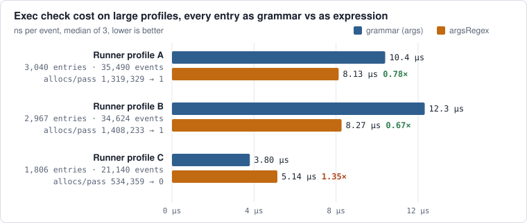

# sbob-go

The reference implementation of the Software Bill of Behaviour matching grammar and collapse rules, as a Go module with no dependencies beyond the standard library.

Current goal: the Kubescape node-agent produces profiles, the bobctl CLI uses this library to generalize them into SBoBs, and the SBoBs are then transpiled into a few known other runtime stacks so that they can read SBoBs too.

Not stable, very much work in progress: this is a prototype to work out the design. See [CONTRIBUTING.md](CONTRIBUTING.md).

## Where it runs

One library, one meaning of a behaviour document, wherever it is evaluated. Solid arrows are in use today. Dashed arrows are the intended routes to other engines and do not exist yet.

### How transpilation is meant to work

A rule is not translated from its CEL text. Another engine receives the document compiled into its own data (lists, selectors, regular expressions) plus a fixed template per rule, which is the projection model of the specification (chapter 7.3). Three parts of this module decide what can be carried:

- `compose` turns the fragments that govern one container into the single profile the engine has to enforce.
- `match` gives the exact verdicts, and renders every path and argument-vector pattern as one full-match regular expression (appendix A of the specification) for engines that evaluate regular expressions.
- `rules` classifies each rule of a rule set as `native`, `generated`, `degraded` or `not-applicable`. Only a rule whose class has been checked against the reference engine may be emitted for another engine; the others are reported.

Where an engine cannot express a pattern, it should not approximate it silently. Kernel-side filters compare whole strings, prefixes and suffixes, so only literal paths and patterns whose only wildcard is a trailing or a leading wildcard segment fit there. Everything else is judged in user space, by this library.

| where | what it does with the document | packages | state |
|---|---|---|---|
| Kubescape node-agent | composes the governing fragments and evaluates the rule set against them for every event; the reference engine | `match`, `compose`, `profile`, `identity`, `conventions`, `collapse` | in use |
| Kubescape storage | consolidates learned profiles, validates documents on admission | `collapse`, `profile`, `match`, `identity`, `conventions` | in use |
| bobctl | generalizes learned profiles, compares, tunes and signs documents | `profile`, `collapse`, `match`, `profilediff`, `conventions` | in use |
| Falco | a generator writes Falco lists and rules from each verified document, scoped by image digest; patterns become `in`, `glob` or full-match `regex` conditions | `compose`, `match`, `rules` | planned |
| Tetragon | a generator writes TracingPolicies for the patterns that fit kernel selectors; a judge on Tetragon's event stream gives exact verdicts for everything else, with the same rule ids | `compose`, `match`, `rules` | planned |
| Kubewarden | a WebAssembly policy that checks documents at admission | `profile`, `match` | planned; the module already compiles to WebAssembly |

## Packages

| package | contents |
|---|---|
| `match` | tokens, path and argument matching, the exec-name rule, the any-sentinel, IP, CIDR and DNS matching and validation, subtract evaluation, argument expressions (`argsRegex`), regular-expression rendering of patterns |
| `collapse` | the path analyzer and its thresholds, exec, open and endpoint collapse over plain values, consolidation, collapse settings |
| `compose` | merging fragments, container sections, the projection of one profile for matching, and the allowed-check per surface |
| `profile` | the behaviour document types, its legacy encoding, validation |
| `profilediff` | the residual between a profile and the documents that bind it, and the stamp that says when it must be recomputed |
| `rules` | the reference rule set by name and engine id, the profile-function catalogue, and the portability classifier |
| `identity` | the workload subject, its string and hashed forms, the storage name of a learned profile, workload identifier build and parse |
| `conventions` | the registry of label and annotation keys, values and kinds |

The specification this module implements, its conventions and schemas are maintained in the SBoB specification repository. Conformance is proven against a separate harness; a green summary is published with each release.

`cmd/wasmcheck` exists only so the module can be compiled with TinyGo for WebAssembly in continuous integration.

## Performance

An exec entry constrains its arguments either with the argument grammar (`args`) or with a POSIX regular expression over the space-joined argument vector (`argsRegex`). Expressions are compiled once per profile and a check allocates nothing; a literal prefix or a fully literal expression is decided without running the regular-expression engine.

The three largest profiles of a recorded set, container profiles of self-hosted CI runners with 1,806 to 3,040 exec entries. Every grammar entry was rewritten as an expression, and the same generated events, matching and near-miss argument lists for each entry, ran through both forms. On the two largest profiles the expression form is faster (0.67× and 0.78×); on the third it costs 1.35×. The grammar allocates up to 1.4 million times per pass over a profile, the expressions at most once. Both forms reach the same verdict on 91,248 of 91,254 events; the six others carry a space inside a single argument, which the joined subject cannot tell apart from two arguments.

Measured with v0.6.0 and Go 1.24 on an x86-64 Xeon at 2.8 GHz, one pinned core, median of three runs.

## Versions

The module version is semantic. A change in matching or collapse semantics is a minor version at least; images built against this module carry the module version as a label.
