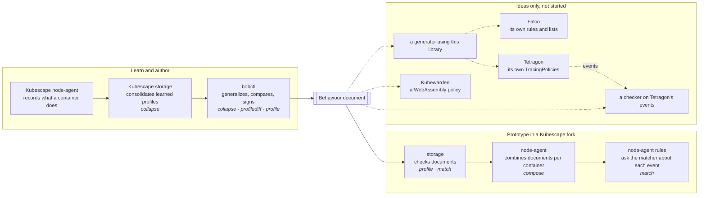

# sbob-go

A prototype Go library for the Software Bill of Behaviour proposal, written to find out whether the ideas in the draft specification hold together. It depends on the Go standard library only.

Please read it as an experiment, not as a product: nothing here is stable, and nothing here should be relied on yet. See [CONTRIBUTING.md](CONTRIBUTING.md) if you would like to comment.

## What we are trying to do

Many tools observe what a workload does at runtime, and each describes that behaviour in its own way. We are exploring whether one shared description of expected behaviour could give users the same experience of runtime profiling, whichever tool they use.

Our current goal: the Kubescape node-agent learns a profile, the bobctl CLI uses this library to generalize it into a behaviour document, and the document could then be translated into a few other runtime tools so that they can read it too. Only the first part is being tried out, in a fork; the translation to other tools is an idea we would like to discuss with their maintainers.

## The picture

Solid arrows are what the prototype tries out today, in a fork of the Kubescape node-agent, its storage and bobctl. Dashed arrows are ideas only; none of them has been started.

### How translation to other tools might work

Our current thinking, open to correction:

- A rule would not be translated from one rule language into another. Each tool would instead receive the expected behaviour as data in its own native form, such as lists, selectors or regular expressions, and keep its own way of writing rules.
- `compose` would work out what applies to one container, and `match` would provide the matching, including a rendering of each pattern as a regular expression for tools that work with regular expressions.
- `rules` sorts each rule into a rough class (`native`, `generated`, `degraded`, `not-applicable`), so that a rule which cannot be carried faithfully is reported instead of being approximated.
- Kernel-side filters, as we understand them, compare whole strings, prefixes and suffixes, so only some patterns would fit there; the rest would have to be checked in user space.

We have not built any of this, and the maintainers of these tools know their designs far better than we do. Corrections are very welcome.

| where | what the prototype does or might do | packages | state |
|---|---|---|---|
| Kubescape node-agent (fork) | combines the documents for a container and checks its events against them | `match`, `compose`, `profile`, `identity`, `conventions`, `collapse` | being tried out |
| Kubescape storage (fork) | consolidates learned profiles, checks documents when they are stored | `collapse`, `profile`, `match`, `identity`, `conventions` | being tried out |
| bobctl | generalizes learned profiles, compares, tunes and signs documents | `profile`, `collapse`, `match`, `profilediff`, `conventions` | being tried out |
| Falco | an idea: generated lists and rules from a document | `compose`, `match`, `rules` | not started |
| Tetragon | an idea: generated TracingPolicies, plus a checker on its events for what a kernel filter cannot express | `compose`, `match`, `rules` | not started |
| Kubewarden | an idea: a WebAssembly policy; the library already compiles to WebAssembly | `profile`, `match` | not started |

## Packages

| package | contents |
|---|---|
| `match` | tokens, path and argument matching, the exec-name rule, the any-sentinel, IP, CIDR and DNS matching and validation, subtract evaluation, argument expressions (`argsRegex`), regular-expression rendering of patterns |
| `collapse` | the path analyzer and its thresholds, exec, open and endpoint collapse over plain values, consolidation, collapse settings |
| `compose` | merging documents, container sections, the projection of one profile for matching, and the allowed-check per surface |
| `profile` | the behaviour document types, its legacy encoding, validation |
| `profilediff` | the difference between a profile and the documents that bind it, and the stamp that says when it must be recomputed |
| `rules` | the draft rule set by name and engine id, the profile-function catalogue, and the portability classes |
| `identity` | the workload subject, its string and hashed forms, the storage name of a learned profile, workload identifier build and parse |
| `conventions` | the names used for label and annotation keys, values and kinds |

The draft specification this library follows is kept in a separate repository and will keep changing. The library is tested against a separate suite of examples drawn from the drafts.

`cmd/wasmcheck` exists only so the library can be compiled with TinyGo for WebAssembly in continuous integration.

## Performance

These are measurements of the prototype, to see whether argument expressions are affordable at all.

An exec entry constrains its arguments either with the argument grammar (`args`) or with a POSIX regular expression over the space-joined argument vector (`argsRegex`). Expressions are compiled once per profile and a check allocates nothing; a literal prefix or a fully literal expression is decided without running the regular-expression engine.

The three largest profiles of a recorded set, container profiles of self-hosted CI runners with 1,806 to 3,040 exec entries. Every grammar entry was rewritten as an expression, and the same generated events, matching and near-miss argument lists for each entry, ran through both forms. On the two largest profiles the expression form is faster (0.67× and 0.78×); on the third it costs 1.35×. The grammar allocates up to 1.4 million times per pass over a profile, the expressions at most once. Both forms reach the same verdict on 91,248 of 91,254 events; the six others carry a space inside a single argument, which the joined subject cannot tell apart from two arguments.

Measured with v0.6.0 and Go 1.24 on an x86-64 Xeon at 2.8 GHz, one pinned core, median of three runs.

## Versions

Versions follow semantic versioning, but before 1.0 anything may change. A change in matching or collapse semantics is a minor version at least.
